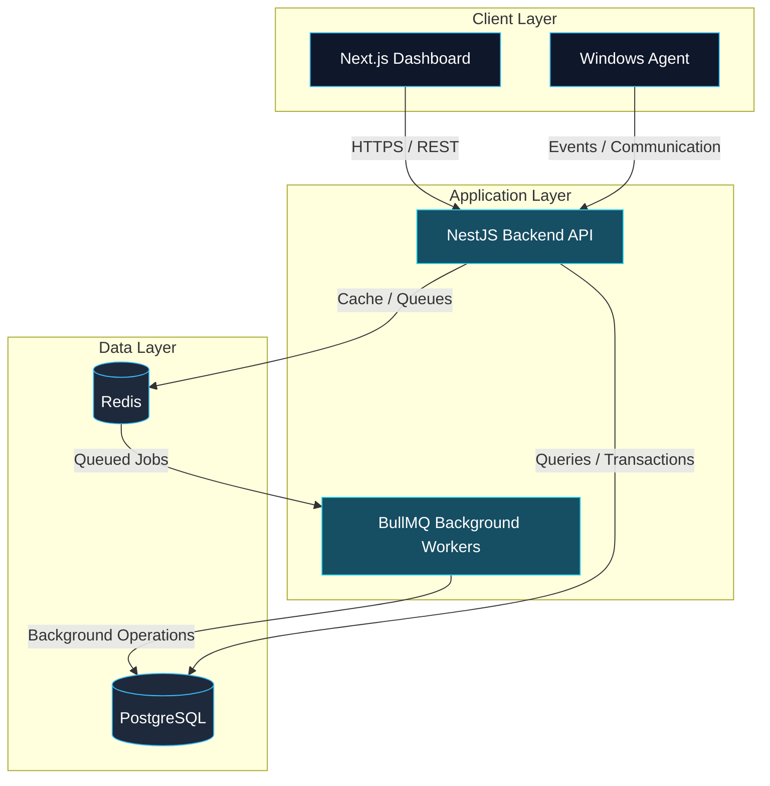

<div align="center">

<!-- ORIGINAL GIF — KEEP THIS -->


<br/>

<!-- ANIMATED HEADER -->


<!-- TYPING ANIMATION -->

<a href="https://github.com/zira2801">
  
</a>

<br/><br/>

<!-- PROFILE BADGES -->


<br/><br/>

<!-- SOCIAL LINKS -->

<a href="https://github.com/zira2801">
  
</a>
<a href="https://www.linkedin.com/in/cao-thanh-duy">
  
</a>
<a href="mailto:duythanhcao456@gmail.com">
  
</a>

</div>

<br/>

---

# 👨‍💻 About Me

I'm a **Full-Stack Developer** based in Ho Chi Minh City, Vietnam 🇻🇳, with hands-on experience building mobile applications, backend services, web platforms, and system integrations.

My primary focus is **Backend Engineering**, with an interest in designing maintainable APIs, database systems, asynchronous processing workflows, and reliable production services.

I enjoy working across the stack — from backend architecture and infrastructure to modern web interfaces and cross-platform mobile applications.

```typescript
const duy = {
  name: "Cao Thanh Duy",
  role: "Full-Stack Developer",
  specialization: "Mobile Developer",

  primaryStack: [
    "TypeScript",
    "NestJS",
    "Next.js",
    "PostgreSQL",
    "Redis",
    "Docker"
  ],

  additionalExperience: [
    "Flutter",
    "Node.js",
    ".NET 8",
    "Windows Services"
  ],

  engineeringInterests: [
    "Backend Architecture",
    "System Integration",
    "Asynchronous Processing",
    "Database Optimization",
    "Distributed Systems",
    "DevOps"
  ],

  currentlyLearning: [
    "Advanced NestJS",
    "Domain-Driven Design",
    "CI/CD",
    "Scalable System Design"
  ],

  philosophy: "Build practical solutions. Keep improving."
};
```

<br/>

## ⚡ Engineering Focus

- 🏗️ **Backend Engineering** — REST APIs, authentication, caching, background jobs, and database design.
- 🌐 **Full-Stack Development** — Building modern applications with Next.js, React, NestJS, and PostgreSQL.
- 🔄 **System Integration** — Connecting desktop agents, backend services, databases, and real-time communication.
- 📱 **Mobile Engineering** — Developing cross-platform Flutter applications using maintainable architecture.
- 🚀 **DevOps & Deployment** — Docker, Nginx, Linux servers, cloud services, and deployment workflows.
- 🧠 **Continuous Learning** — Exploring system design, distributed architectures, and backend performance.

<br/>

---

# 🛠️ Technology Stack

<div align="center">

### ⚙️ Backend & Runtime


<br/>

### 🌐 Frontend & Mobile


<br/>

### 🗄️ Databases & Data Processing


<br/>

### 🐳 DevOps & Infrastructure


<br/>

### ☁️ Cloud & Development Tools


</div>

<br/>

---

# 🚀 Featured Engineering Projects

## 🛡️ Enterprise Endpoint Monitoring & Data Protection

**Full-Stack Development · Backend Engineering · Windows Agent Integration**

An enterprise-oriented endpoint monitoring and data protection platform integrating Windows agents with a centralized backend and web management system.

**Technology Stack**


### Key Engineering Contributions

- Developed backend services for device management, monitoring events, and system operations.
- Integrated Windows-based agents with centralized backend services.
- Implemented asynchronous processing workflows using Redis and BullMQ.
- Worked with real-time communication for remote device monitoring.
- Developed management interfaces using Next.js and React.
- Implemented authentication and refresh-token management with Redis.
- Worked on remote agent updates and version distribution using Velopack.
- Integrated native Windows components for screen and audio recording.
- Containerized and deployed backend and frontend services using Docker and Nginx.

> 🔒 Professional project experience. Source code and internal implementation details are not publicly available.

<br/>

## 📱 Event Management Platform

**Personal Project · Flutter · Backend Development**

A cross-platform event management platform combining a Flutter mobile application with a TypeScript backend and relational database.

**Technology Stack**


### Key Features & Engineering Work

- Built a Flutter mobile application using BLoC and Clean Architecture principles.
- Developed RESTful APIs with Node.js, Express, and TypeScript.
- Designed relational data models using PostgreSQL and Prisma ORM.
- Implemented authentication, user management, and event-related workflows.
- Integrated Redis for caching and background processing.
- Worked with cloud storage and third-party service integrations.
- Explored AI-powered functionality and semantic search.

**Development Status:** 🟢 Active Development

<br/>

## 📲 Cross-Platform Mobile Applications

**Professional Flutter Development Experience**

Experience developing, optimizing, and maintaining Flutter applications.

### Technical Highlights

- Applied BLoC, Provider, Riverpod, and dependency injection patterns.
- Structured application modules using Clean Architecture.
- Integrated REST APIs and external services.
- Improved application performance and loading behavior.
- Worked with Android release and deployment processes.
- Maintained and enhanced existing mobile application features.

<br/>

---

# 🏗️ Architecture & System Design

I enjoy understanding how different components interact to build reliable software systems.

The following diagram illustrates a **simplified reference architecture** for an agent-connected management platform.



> This diagram is a conceptual example and does not disclose the actual production architecture of any private system.

<br/>

---

# 🧩 Engineering Principles

```text
01  /  Design for maintainability
02  /  Understand before optimizing
03  /  Build reliable backend services
04  /  Keep architecture practical
05  /  Automate repetitive workflows
06  /  Measure performance, don't guess
07  /  Learn continuously through real projects
```

<br/>

---

# 📊 GitHub Analytics

<div align="center">


<br/><br/>


<br/><br/>


</div>

<br/>

---

# 🐍 Contribution Activity

<div align="center">

<picture>
  <source media="(prefers-color-scheme: dark)" srcset="https://raw.githubusercontent.com/zira2801/zira2801/output/github-snake-dark.svg"/>
  <source media="(prefers-color-scheme: light)" srcset="https://raw.githubusercontent.com/zira2801/zira2801/output/github-snake.svg"/>
  
</picture>

</div>

<br/>

---

# 🌱 Currently Exploring

```yaml
backend_engineering:
  - Advanced NestJS Architecture
  - Domain-Driven Design
  - Database Performance
  - Background Job Processing

system_design:
  - Distributed Systems Fundamentals
  - Caching Strategies
  - Message Queues
  - Reliability & Scalability

devops:
  - Docker & Container Networking
  - Linux Server Administration
  - Nginx Reverse Proxy
  - CI/CD Automation
```

<br/>

---

# 💭 Development Philosophy

<div align="center">

### "Build for today. Design for tomorrow."

**Clean Code · Practical Architecture · Continuous Improvement**

*Good software is not only about making things work.*

*It's about building systems that remain understandable, maintainable, and reliable as they grow.*

</div>

<br/>

---

# 📬 Let's Connect

<div align="center">

I'm interested in opportunities involving **Full-Stack Development, Backend Engineering, and Software Architecture**.

Feel free to connect, collaborate, or discuss interesting engineering challenges.

<br/>

<a href="mailto:duythanhcao456@gmail.com">
  
</a>

<a href="https://www.linkedin.com/in/cao-thanh-duy">
  
</a>

<a href="https://github.com/zira2801">
  
</a>

<br/><br/>


<br/><br/>


</div>
